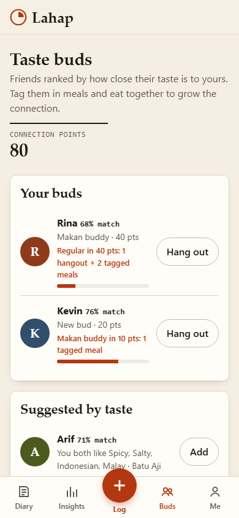
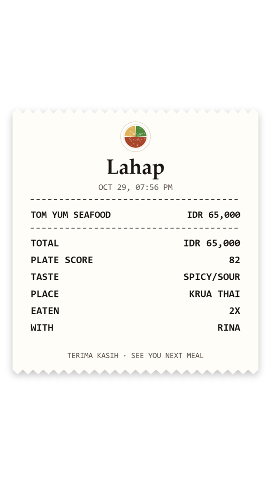

# Lahap: a food diary you can search

Live: https://juw12.github.io/lahap/ (add `?demo=1` for a sample fortnight)

 
 

Offline-first web app (PWA). No account, no server: meals and photos stay in the browser (IndexedDB).

Run locally: serve this folder (e.g. `python -m http.server 8765`) and open http://127.0.0.1:8765/ .
Add `?demo=1` to load a sample fortnight.

What it does
- Log a meal fast: photo (optional), dish with "seen before" prefill, place, cuisine, price, taste, plate balance, rating, buds.
- Search "Have I eaten this?": count, last time and place, average price and range, plate score, rating.
- Insights: variety score (Simpson diversity of dishes + cuisines), plate score by day, spend (out/home/delivery),
  taste radar, cuisines, top places.
- Share cards like Strava: Card / Receipt / Stats templates, Paper / Dark / Photo / Transparent backgrounds,
  Story 9:16 or Post 1:1, saved as PNG or sent through the phone's share sheet.
- Taste buds: match % from your taste profile, add buds, tag them in meals (+10 points), plan a hangout and send it
  by WhatsApp, mark "We went" (+25), levels New bud, Makan buddy, Regular, Family table.
- Backup export/import (JSON), currency setting.

Limits (honest)
- Plate score is a rule of thumb from the portions you tick, not nutrition analysis or medical advice.
- Buds are sample profiles: there is no server yet, so friends, matching and points live on this device only.

Tests: `python tests/test_app.py` (Playwright). Design rules: `design.md`.

Why another food diary: PlateDiary is a private restaurant photo journal and Mynu is a home-cooking journal.
Lahap logs both (ate out, home-cooked, delivery), answers "have I eaten this before?" with price and plate score,
and adds Strava-style share cards plus taste buds you earn points with by eating together.

Licence: MIT.
