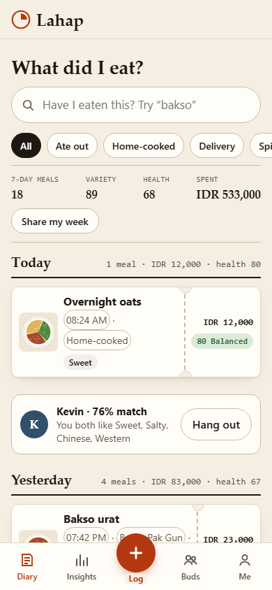
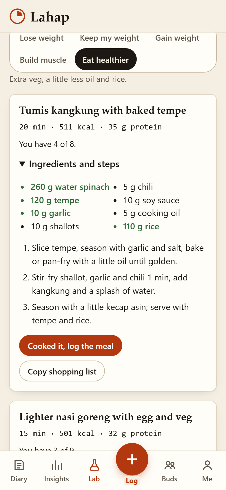
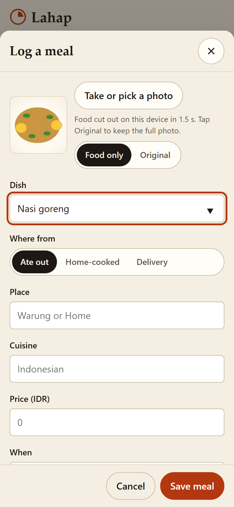
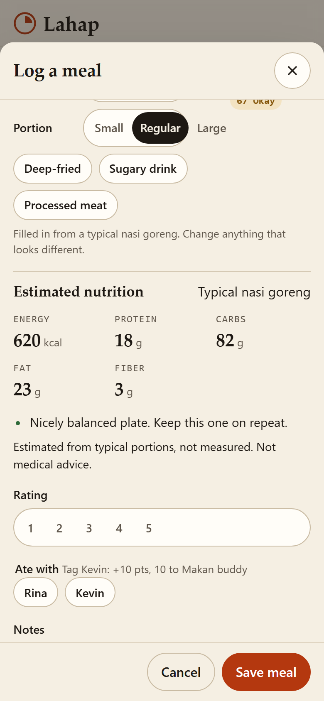
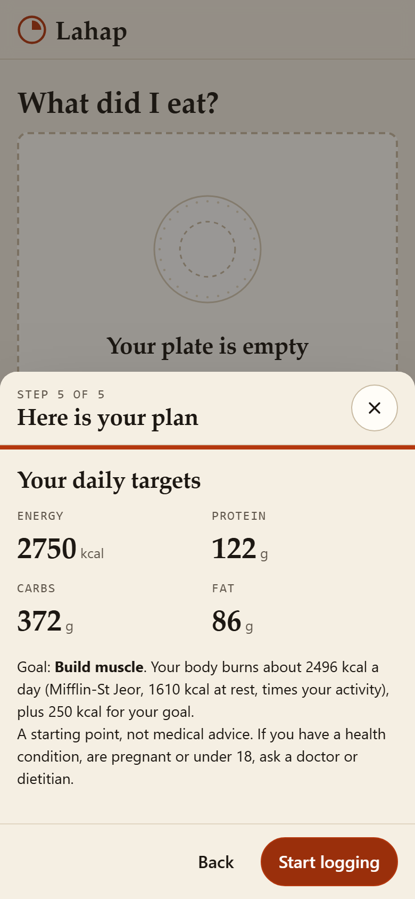
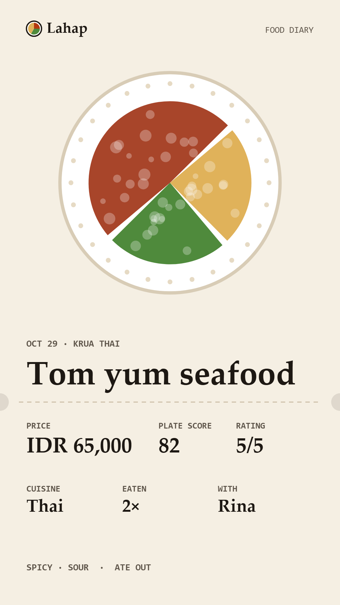

# Lahap: a food diary you can search

Live: https://juw12.github.io/lahap/ (add `?demo=1` for a sample fortnight)

 
 
 

Offline-first web app (PWA). No account, no server: meals, photos and your goal stay in the browser (IndexedDB).
Open https://juw12.github.io/lahap/ (no `?demo`) to start your own diary; it opens empty and saves every meal on the device.

Run locally: serve this folder (e.g. `python -m http.server 8765`) and open http://127.0.0.1:8765/ .
Add `?demo=1` to load a sample fortnight, `?noquiz=1` to skip the first-run quiz.

What it does
- Goal quiz on first run (skippable, retake from Profile): goal, body, activity, cooking time, diet. It works out daily
  calories (Mifflin-St Jeor times activity, plus or minus your goal) and protein per kg, and shows the maths.
- Log a meal fast: photo (optional), dish with "seen before" prefill, place, cuisine, price, taste, plate balance,
  portion, rating, buds.
- Food-only photos: the background, plate and cutlery are removed on the device (U-2-Net small model in the browser),
  so tickets, the detail view and share cards show just the food. "Original" keeps the full photo.
- Nutrition estimate and tips: kcal, protein, carbs, fat and fiber from typical recipes for known dishes, or from the
  plate you tick, scaled by portion. Today bar shows calories and protein against your targets, with one tip.
- Lab: type what is in your kitchen, say it (English or Bahasa Indonesia), or scan a written list or receipt.
  Set List language to Bahasa and the scanner reads with the Indonesian OCR model too. It knows everyday bumbu
  (lengkuas, daun salam, kemiri, terasi, kunyit, ketumbar, gula merah, asam jawa, daun jeruk).
  Lahap ranks home recipes by what you have, sizes them to your goal and diet, and fits your cooking time.
  "Cooked it, log the meal" fills in the log; "Copy shopping list" copies what is missing.
- Search "Have I eaten this?": count, last time and place, average price and range, plate score, rating.
- Insights: variety score (Simpson diversity of dishes + cuisines), plate score by day, spend (out/home/delivery),
  taste radar, cuisines, top places.
- Share cards like Strava: Card / Receipt / Stats templates, Paper / Dark / Photo / Transparent backgrounds,
  Story 9:16 or Post 1:1, the food cut-out drawn as a sticker, saved as PNG or sent through the share sheet.
  Every meal surface has one-tap share — the chip on each diary ticket, plus "Share card" on the
  On-repeat hero and the search answer card — so a past meal is as quick to share as a new one.
- Favourites: tap the heart on a meal; the heart in the search bar shows only those.
- Stamp book (Insights): every place you ate out becomes a stamp with its visit count, and a place turns "regular"
  at 3 visits. Tap a stamp for the place page: visits, spend, what you ordered and who you went with.
- Bud pages: tap a bud to see every meal you shared, where you went together and what you ordered, then log or plan
  the next one.
- "Makan apa?" picker: can't decide? It picks from dishes you already rated well and have not had lately
  (all, eat out or home), never the same pick twice in a row, and one tap starts the log.
- Recap slip: a receipt for any month or year (meals, new dishes, new places, top dish, top place, spend), with
  "Copy" to paste it into a chat.
- Numbers off (Profile): one switch hides calories, nutrition and plate scores on your meals, for a plain photo
  and memory diary. Prices and ratings stay.
- Home-screen shortcuts: long-press the installed icon for "Log a meal" and "Makan apa?".
- Taste buds: match % from your taste profile, tag buds in meals (+10 points), plan a hangout by WhatsApp,
  mark "We went" (+25), levels New bud, Makan buddy, Regular, Family table.
- Invite links: "Invite a bud" shares a link that carries only your taste profile (no meals); your friend
  opens it, sees "<name> wants to compare tastes" and adds you with one tap. No account, no server.
- Save, sync and share (Profile): Share backup (phone share sheet) or Save backup file, then Restore or merge on another
  device. Meals are matched by id, the newest edit wins and deleted meals stay deleted, so syncing twice never doubles
  anything. It is file-based sync, not a cloud: nothing moves until you share the file.
- Crash-safe logging: the meal you are typing is kept as a draft on every change, so if the phone reloads the tab (camera
  app, low memory) the sheet reopens with everything you entered. Photos decode straight to 1080 px, auto cutout can be
  turned off and switches itself off if it ever ran a phone out of memory, and saves retry when a sleeping phone drops the
  database connection. If the browser blocks storage (private tab) the diary says so instead of losing meals.
- One tap removes the sample fortnight if it ever got mixed into a real diary. Currency setting.

Limits (honest)
- Nutrition numbers are estimates from typical portions and recipes, not measurements and not medical advice.
  Lahap does not recognise the dish from the photo: you pick or type it.
- Food cut-out: about 1.5 to 3.5 s on a laptop, about 3 to 4 s per photo on a phone-speed CPU (emulated 4x
  slowdown; almost all of it is the model itself). The first one also downloads about 18 MB. The plate trim learns the plate's own
  tint from its rim, so warm or greenish white sides (krupuk, cucumber) stay; food the exact tint of the plate
  can still go with it, and thin bowl rims can stay. Tap "Original" if it looks wrong.
- Scan a list reads printed or neatly written lists and receipts (English, or English + Indonesian when List language is Bahasa), not photos of food.
- Voice needs a browser with speech recognition (Chrome, Edge, Android, Safari); Firefox users can type.
- The models (about 37 MB: onnxruntime-web, U-2-Net small, Tesseract English + Indonesian) load only the first time you use a photo or
  scan, then stay cached for offline use.
- Install: Chrome / Android shows "Install app" or "Add to Home Screen"; on iPhone use Safari, Share, Add to
  Home Screen. It opens full screen with its own icon. `python tests/device_check.py` runs the camera photo,
  cut-out, Bahasa voice and share sheet in iPhone (WebKit) and Android (Chromium) profiles; not yet on a real handset.
- Suggested buds are example profiles. Invited buds are real but one-way snapshots: there is no server, so buds,
  matching and points live on each device and do not sync after the invite.

Tests: `python tests/test_app.py` (Playwright, 425 checks, including a real cut-out and OCR run). Design rules: `design.md`.

Lahap vs PlateDiary (checked against platediary.app on 13 Nov 2026)

PlateDiary is a polished native app for iPhone and Android: a private photo journal for eating out, with a free tier,
a paid Premium tier and a separate AI add-on. Lahap is a free web app with no paid tier. Both keep the diary on your
device with no account.

What Lahap now matches from PlateDiary's free tier, in its own receipt-and-stamp look: favourites, a stamp book of
places, place pages, pages for the people you eat with, a craving picker, a recap you can share, calories off when
you do not want them, and food cut-outs.

Where Lahap goes further
- Nothing to install and no store: it opens in any browser on phone or laptop, and works offline after the first visit.
- Everything is free. There is no Premium tier and no AI add-on to buy.
- Search answers "have I eaten this?" with count, last time and place, price range and rating in one card.
- Eating out, home-cooked and delivery live in one diary, with spend split across the three.
- Nutrition estimates against your own goal (quiz, daily bar, one tip), and a single switch to hide all of it.
- Lab turns what is in your kitchen into ranked recipes and a shopping list, typed, spoken or scanned.
- Share cards in three templates and four backgrounds, free.

Where PlateDiary is still ahead (not built here)
- It is a native app from the App Store and Google Play, with home-screen widgets.
- One photo of the whole table becomes separate dish cut-outs; Lahap cuts out one photo per meal.
- Cutout collage maker, a food map, collections, themes (its Look & feel studio) and games.
- Backups to your own iCloud Drive or a Google Drive file; Lahap's backup is a file you share yourself.
- Bill and receipt scan that fills in prices; Lahap's scanner reads ingredient lists for the Lab only.
- AI that names dishes from the photo (paid add-on there); Lahap never recognises the dish, you pick or type it.
- More than a dozen app languages; Lahap's interface is English, with Bahasa Indonesia input in the Lab.

Third-party files in `vendor/`: onnxruntime-web (MIT, Microsoft), U-2-Net small model (Apache-2.0, Xuebin Qin et al.),
tesseract.js and its English data (Apache-2.0).

Licence: MIT.
